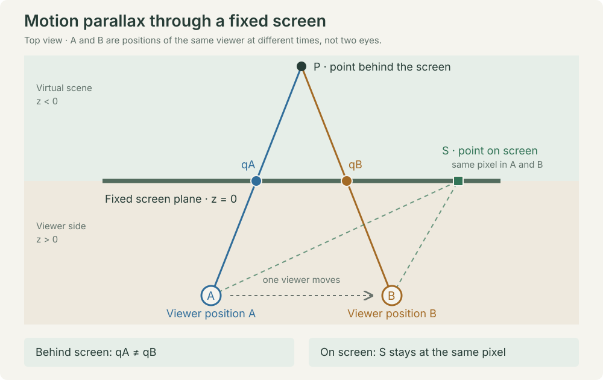

# Parallax & Sway

A static browser playground for head-coupled perspective, local 3D models and sensor-driven accessories. [日本語](README.ja.md)

[Try the live demo](https://liaru-lab.github.io/web-parallax/) · [Source repository](https://github.com/liaru-lab/web-parallax)

The default Deskbot and studio scene are generated by the app. No third-party character is bundled. Choose a local **GLB/glTF** or **MMD PMX/PMD** model, change its placement, background and lights, and try webcam tracking or phone motion sensors. MMD supports VMD and morphs; glTF supports embedded animation clips and morphs. Japanese and English UI are available.

## How it works

The screen is a fixed window into the scene. Webcam landmarks estimate the viewer's head position; an off-axis perspective frustum projects the scene through that window. Moving your head changes depth-dependent motion and occlusion. This is motion parallax for one viewer, not gaze tracking or separate left/right-eye images.



Phone acceleration drives small spring offsets on accessory bones, independently of the camera viewpoint. Local model animations and morphs are evaluated before those offsets are applied.

[Technical explanation](docs/how-it-works.md) · [同内容の日本語版](docs/how-it-works.ja.md) · [References and prior work](docs/references.md) · [BibTeX](docs/references.bib)

```sh
npm ci
npm run dev
```

Open http://localhost:5173/. Use HTTPS when accessing camera/sensors from another device. Node.js 22.12+ is required; Node 24 is recommended. The install step copies MediaPipe WASM and downloads the pinned face-tracking model from Google with SHA-256 verification. Camera frames and selected files are processed locally and are not uploaded.

```sh
npm test
npm run build
npm run check:release
npm run release
```

`release/source/` is a source distribution suitable for a new GitHub repository. `release/site/` is the reviewed static site. Matching tar.gz archives are generated. **These commands do not publish anything.** `dist/`, `.local/`, `release/`, credentials and local environment settings are not committed. Do not add your own restricted assets to `public/`: unreviewed public files fail the build.

The supplied Pages workflow runs **only on manual dispatch**. Pushing a commit does not update the live demo automatically. Relative asset paths support GitHub Pages project subdirectories; [deployment instructions](docs/release.md) explain how to publish an update.

- [Technical explanation and diagrams](docs/how-it-works.md)
- [Help](docs/demo.md)
- [Models, backgrounds and lighting](docs/models.md)
- [Calibration and privacy](docs/calibration.md)
- [License audit](docs/license-audit.md)
- [References](docs/references.md)
- [Third-party notices](THIRD_PARTY_NOTICES.md)
- [Verification](docs/verification.md)

Project code and original procedural geometry: [MIT](LICENSE). Dependencies and the optional CC0 DiSK motion files retain their own licenses. User-selected models/images/motions retain their authors' terms; selecting them locally does not grant permission to redistribute them or publish unrestricted recordings. See the audit and in-app credits.
