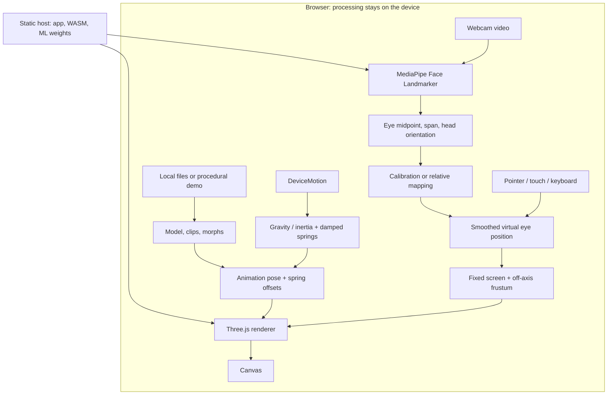

# 仕組みと実装

[English](how-it-works.md) · [README](../README.ja.md) · [参考文献](references.md)

Parallax & Swayは、ディスプレイを**3D空間をのぞく窓**として扱います。1人の観察者の頭の位置を推定し、その位置に仮想カメラを置いて、固定した画面の長方形を通してシーンを投影します。頭を動かすと見える範囲や物の重なり方が変わり、奥行きを感じられます。この仕組みが**頭部位置に追従する透視投影（head-coupled perspective）と運動視差**です。

測っているのは頭の位置で、どこを注視しているかではありません。画面には1枚の画像を表示します。左右の目に別々の画像を届ける方式や、空間ディスプレイの光学系を再現するものではありません。

## 1. 画面を「窓」として固定する


*このプロジェクトで作成した概念図です。AとBは同じ人の異なる時刻の位置で、左右の目を表しているわけではありません。*

画面より奥の点を見る光線は、頭を動かすと画面を横切る位置が変わります。画面平面上の点は、頭を動かしても同じ画素に残ります。この違いで運動視差が生まれます。画面平面に近い物と遠い物では動きの量が異なり、手前の物の陰に隠れていた部分も見えるようになります。

座標は、画面の右が`+X`、上が`+Y`、観察者側が`+Z`です。画面は`z = 0`、通常の後景は`z < 0`に置きます。モデルは画面より手前にも移動できますが、観察位置やクリッピングによって見切れる場合があります。

`src/scene.js`では、`PerspectiveCamera`を推定した目の位置に置きます。Three.jsの[`CameraUtils.frameCorners`](https://threejs.org/docs/pages/module-CameraUtils.html)に画面の左下・右下・左上を渡し、**非対称な透視投影（off-axis projection）**を作ります。見る方向は固定された画面の角から決まるため、仮想カメラの位置が動いても、ディスプレイと窓の関係を保てます。

理想的な校正条件では、画面平面上にある3Dの点は、頭を動かしても同じ画素へ投影されます。`tests/math.test.js`ではこの性質を検査しています。「視差の強さ」は動きを意図的に拡大・縮小する設定で、校正後は`1.0`が実寸に合わせた基準です。

考え方の背景は[Fish Tank Virtual Reality［R1］](references.md#r1-fish-tank-virtual-reality)、モバイルのカメラを使う近い先行例は[Francone・Nigay［R2］](references.md#r2-mobile-head-coupled-perspective)です。R1には両眼立体視も含まれます。このアプリで扱うのは1枚の画像による頭部追従の部分で、どちらの論文の実験も再現していません。

## 2. 入力から描画まで



ホスト側は静的ファイルを配信します。推論やモデルアップロードを受けるアプリ用バックエンドはありません。カメラ映像・選択モデル・センサー値はブラウザ内で処理します。一方、ページや実行用素材を取得する通常の通信は発生します。保存と通信の範囲は[校正とプライバシー](calibration.md)に記載しています。

### 頭の位置

`getUserMedia()`の映像を非表示のvideo要素へ渡します。MediaPipe Face Landmarkerを1人・`VIDEO`モードで動かし、可能ならGPU、初期化に失敗した場合はCPUを使用します。取得するのは顔のランドマークと顔の変換行列です。

`src/math.js`の`faceSample()`は、虹彩中心のランドマーク**468と473**から中点と間隔を計算します。顔の変換行列は、向きや投影による短縮をおおまかに補正するために使います。虹彩を取得できない場合も、目尻のランドマークで未校正の相対モードは動かせますが、虹彩を使う校正の基準には採用しません。

未校正では、基準の顔からの変化を、上限・下限を持つ仮想座標へ変換します。距離は初期状態では固定し、前後追従を有効にした場合は顔の間隔の比率を使います。このモードの数値はセンチメートルの測定値ではありません。

推論の間隔は最低**80ms**とし、描画は`requestAnimationFrame`で更新します。現在は両方ともメインスレッドで動いており、更新頻度を分けているだけで、別Workerに並列化してはいません。目の位置には`alpha = 1 - exp(-14 * dt)`の指数平滑化を使います。約**700ms**顔が見つからなければ、目標位置を中央へ戻します。無効な値や大きすぎる顔の回転は、視点の大きな跳ねに変換せず除外します。

### 距離と画面の校正

使用する情報は次の通りです。

| 入力 | 用途 |
| --- | --- |
| 画面の線を定規の3cmに合わせる | 物理的な1cmあたりのCSSピクセル数 |
| 実測した画面から目までの基準距離`D0` | その人の距離の基準 |
| 分かる場合の瞳孔間距離`I`、不明なら仮値 | 焦点距離の比率と左右・上下移動の縮尺 |
| 基準時の両目の中点と間隔 | カメラと表示領域の中心がずれている影響の近似補正 |

`p0`を、画像横幅で正規化し、向きを近似補正した基準時の虹彩中心間隔とします。`I`をcmで表すと、次の関係を使えます。

```text
f = p0 * D0 / I          推定焦点比（焦点距離 / 画像横幅）
D = f * I / p           現在の補正済みの間隔pから求める距離
  = D0 * p0 / p
```

例えば基準が`D0 = 50 cm`、`p0 = 0.12`で、現在の間隔が`p = 0.15`なら、距離は約`40 cm`と推定します。個人ごとの実測基準がある場合、距離の比率から`I`は約分されます。ただし`I`の仮定は左右・上下移動の縮尺には影響します。

逆投影では、画像内の中点の差を取るだけでなく、基準時の光線を含めます。画像内の横座標を`u`、基準を`u0`とすると、実装の近似式は次の通りです。

```text
X = ((u0 - 0.5) * D0 - (u - 0.5) * D) / f
```

これは、カメラが画面中央より上や横にある場合に重要です。近づいただけで横・上下にも移動したことになる誤差を減らします。縦方向にはさらに画像の縦横比を反映し、定規から得た縮尺で、投影窓と目の座標を同じ仮想単位に揃えます。

基準取得は**12サンプル**で、ほぼ正面（約12度以内）を要求し、間隔や位置の変動が大きければ拒否します。追従では約35度までの広い範囲を許します。全画面の前後ではピクセルの縮尺を保ち、表示領域の中心の移動を補正します。端末の回転や撮影画像の縦横比が変わった場合は、基準を取り直します。

[MediaPipe Irisの記事［R5］](references.md#r5-mediapipe-iris)で紹介される**虹彩の直径**による距離推定とは異なり、この実装は虹彩中心どうしの間隔と、その人の実測距離を使います。記事の精度値をこのアプリの実測精度として扱っていません。また、画面を校正してもモデルの実際の身長が復元されるわけではありません。モデルは仮想ステージに正規化し、利用者が大きさを調整します。

## 3. モーション・表情・揺れもの

アニメーションには2つの経路があります。

| モデル形式 | 再生方法 |
| --- | --- |
| MMDのPMX／PMD | `MMDLoader`と`MMDAnimationHelper`でVMDを再生。ボーン名の対応、IK、付与変形を扱う |
| GLB／glTF | `GLTFLoader`と`AnimationMixer`でモデル内のクリップを再生 |

表情にはモデルのモーフを使います。手動で選んだ場合は前の表情を解除し、選択した重みへ滑らかに近づけます。自動モードではクリップ内の表情を優先し、それがない場合は対応するまばたきモーフを時間変化させます。Webカメラの表情をモデルへ転写する機能ではありません。モーフ名・クリップ名は元データの名前をそのまま表示します。

揺れものは別の小さな近似です。`DeviceMotionEvent`から重力込み加速度と、取得できれば線形加速度を受け取ります。`screenVector()`でX・Y成分を画面の向きに合わせて回転します。重力は線形加速度を差し引いて推定し、線形加速度がない場合は低域通過フィルターで近似します。

名前で選んだ髪・リボン・紐・アンテナの根元ボーンに、2軸の減衰ばねを与えます。各軸の計算は次の形です。

```text
角加速度 = 48 * (目標角度 - 現在角度) - 7 * 角速度
角速度 += 角加速度 * h
角度 += 角速度 * h
```

計算刻みは最大`1/120秒`、1フレームの経過時間は最大`0.05秒`に制限し、角度にも上限を設けます。係数は見た目の反応を調整する値で、材質の実測物性ではありません。剛体、ボーン連鎖の衝突解法、髪と体の接触は実装していません。

毎フレーム、揺れものの基準姿勢を戻し、モデルのアニメーションを評価した後に、ばねの回転をクォータニオンの差分として加えます。同じ差分がフレームごとに積み重なり続けるのを防ぐためです。センサーは揺れものだけに使い、仮想カメラ位置へ再度積分して加えてはいません。一時停止ボタンはクリップの再生を制御し、自動まばたき・補助的な待機動作には別のチェックボックスがあります。

## 4. ファイル読み込みと描画

`src/local-assets.js`は、選択されたファイルをThree.jsの`LoadingManager`経由で一時的なBlob URLへ対応付けます。テクスチャやバッファはその選択範囲内で解決します。HTTP／file参照を拒否し、glTFの参照を事前検査します。差し替えに失敗した場合は前のモデルを保ちます。読み込み後はBlob URLを解除し、差し替えた形状・材質・テクスチャ・アニメーションの資源を解放します。メモリーへの読み込みであり、アップロードではありません。

初期モデルDeskbotは`src/demo-model.js`で基本形状から生成します。背景画像は遠くの板に、縦横比を維持してクロップ表示します。画像を3Dの風景へ復元したり、床全体へ投影したりはしません。照明は環境光と平行光源を使い、環境の復元は行いません。

MMD互換処理では、PMXの片面・両面設定の保持、テクスチャの透明性判定の材質への反映、完全透明な画素の破棄、シェーダーを壊す空のモーフ配列の除去を行います。髪の影で顔が暗くならないよう、モデル全体のセルフシャドウを既定でOFFにし、床への影は残します。MMDのレンダラーや物理エンジンをすべて再現する実装ではなく、明示的に選んだ表示上のトレードオフです。

読み込めたことを、その素材の公開許諾があることとはみなしません。同梱素材の条件は[ライセンス確認](license-audit.md)、アプリ内のクレジット（ソースでは`public/credits.html`）、[third-party notices](../THIRD_PARTY_NOTICES.md)に整理し、利用者のファイルには元の利用条件が適用されます。

## 5. ソースコードの対応表

| ファイル | 役割 |
| --- | --- |
| `src/main.js` | 権限、基準取得、UI状態、入力の取得と描画ループ |
| `src/math.js` | 顔の計測、校正、画面座標への回転、ばね |
| `src/scene.js` | 画面の角と投影、モデル配置、照明、背景、描画 |
| `src/model-animation.js` | MMD／glTFの再生、表情の混合、簡易待機動作・まばたき |
| `src/local-assets.js` | ローカル参照の解決、読み込み検査と資源解放 |
| `src/tracking-preview.js` | カメラ画素をコピーしない汎用の顔の模式図 |
| `src/demo-model.js`、`src/i18n.js` | 手続き生成モデルと日英UI |
| `scripts/check-public-assets.mjs`、`scripts/check-release.mjs` | 素材の許可一覧・チェックサムと配布物の検査 |

## 6. 確認できた範囲と限界

数式のテストでは、画面平面上の点が動かない投影、相対距離、校正例、無効な入力、ばねの有界性を検査します。ブラウザでは読み込み・アニメーション・プライバシーの境界・言語切り替え・全画面を確認しています。[確認結果](verification.md)に、実施した範囲と実機確認の残りを記載しています。

1人の観察者に向けた視覚デモです。レンズ歪みやカメラ・画面間の完全な校正、左右の目への画像分離、絶対距離の精度保証、任意骨格へのVMD変換、MMDの完全な衝突物理はありません。ここで使う図は説明用に新しく作成したもので、論文の図や製品画像を転載していません。
