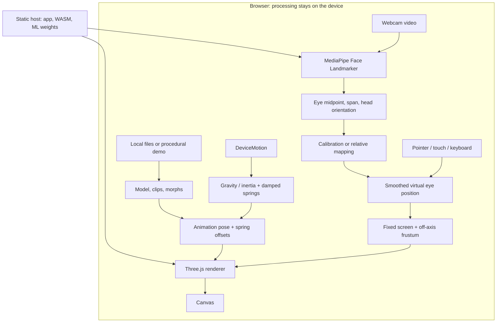

# How it works

[日本語](how-it-works.ja.md) · [README](../README.md) · [References](references.md)

Parallax & Sway treats the display as a **window into a 3D scene**. It estimates one viewer's head position, places a virtual camera at that position, and projects the scene through the fixed screen rectangle. Moving your head changes which parts of the scene are visible and how objects overlap. This is **head-coupled perspective / motion parallax**.

The app estimates head position, not where your gaze lands. It renders one image for the display; it does not send separate images to the two eyes or reproduce a spatial display's optical system.

## 1. The screen is the window


*Original project diagram. A and B are the same viewer at different times. They are not the left and right eyes.*

For a point behind the display, the ray from the viewer to that point intersects the screen at a different pixel as the viewer moves. A point on the display plane keeps its screen location. This difference creates motion parallax. Objects closer to the screen plane move less than distant objects; occlusion also changes as you look around a foreground object.

The coordinate convention is `+X` to screen-right, `+Y` up, and `+Z` toward the viewer. The screen lies on `z = 0`; virtual scenery usually lies at `z < 0`. Models can also be placed in front of that plane, subject to clipping and the current eye position.

In `src/scene.js`, a `PerspectiveCamera` is placed at the estimated eye position. Three.js [`CameraUtils.frameCorners`](https://threejs.org/docs/pages/module-CameraUtils.html) receives the bottom-left, bottom-right and top-left screen corners and builds an **off-axis perspective frustum**. We do not rotate an orbit camera toward the model: that would change the relationship between the virtual window and the display.

In an ideal calibrated setup, a 3D point on the window plane projects to the same pixel as the eye moves. `tests/math.test.js` checks this property. The separate **parallax strength** control deliberately exaggerates or reduces motion; `1.0` is the physical-scale baseline after calibration.

This follows the head-coupled display idea discussed in [Fish Tank Virtual Reality, R1](references.md#r1-fish-tank-virtual-reality) and mobile camera-based HCP in [Francone and Nigay, R2](references.md#r2-mobile-head-coupled-perspective). R1 includes stereoscopic display as well; this app implements only the single-image head-coupled part, and does not reproduce either paper's experiments.

## 2. The runtime pipeline



The host delivers static files. There is no application backend for inference or model uploads. Camera frames, selected models and sensor samples are processed inside the browser. The host still receives normal requests for the page and its runtime assets. See [privacy and calibration](calibration.md) for the exact storage and network boundaries.

### Head position

`getUserMedia()` supplies a hidden video element. MediaPipe Face Landmarker runs in `VIDEO` mode for one face, using a GPU delegate when available and falling back to CPU if initialization fails. It returns facial landmarks and a face transformation matrix.

`faceSample()` in `src/math.js` uses the midpoint and separation of iris-center landmarks **468 and 473**. The face transform provides approximate orientation and foreshortening correction. If iris landmarks are unavailable, eye-corner landmarks can still support the uncalibrated relative mode; they are not accepted as an iris-based calibration reference.

Without calibration, changes relative to the reference face map to bounded virtual coordinates. Depth is fixed initially; optional relative depth uses the ratio of reference/current face span. This mode is a convenient visual approximation, not a centimeter measurement.

Inference is attempted at intervals of at least **80 ms**, while rendering uses `requestAnimationFrame`. Both currently run on the main thread: they have different update rates, not separate worker threads. The eye position is smoothed with an exponential response, `alpha = 1 - exp(-14 * dt)`. If no recent face is found for about **700 ms**, the target returns toward the neutral view. Invalid samples and excessive head turns are rejected rather than converted into large viewpoint jumps.

### Distance and screen calibration

The inputs are:

| Input | Purpose |
| --- | --- |
| A displayed line matched to 3 cm on a ruler | CSS pixels per physical centimeter |
| Measured reference screen-to-eye distance `D0` | Establishes personal depth scale |
| Known/provisional pupil distance `I` | Sets the camera focal ratio and lateral/vertical scale |
| Reference eye midpoint and span | Accounts approximately for the camera being offset from the view center |

Let `p0` be the reference iris-center span normalized by image width, corrected approximately for orientation. With `I` in centimeters:

```text
f = p0 * D0 / I          estimated focal ratio (focal length / image width)
D = f * I / p           current depth from current corrected span p
  = D0 * p0 / p
```

For example, `D0 = 50 cm`, `p0 = 0.12` and a later `p = 0.15` give an estimated `D = 40 cm`. With a measured personal reference, `I` cancels from the depth ratio; its assumed value still affects the lateral/vertical scale.

Back-projection includes the reference ray rather than merely subtracting image midpoints. For horizontal image coordinate `u` and reference `u0`, the implemented approximation is:

```text
X = ((u0 - 0.5) * D0 - (u - 0.5) * D) / f
```

This matters when the camera is above or beside the view center: approaching it should not by itself produce a false sideways/upward movement. Vertical coordinates additionally account for image aspect ratio. The ruler scale then puts the projection window and estimated eye coordinates into a consistent virtual unit system.

Reference capture takes **12 samples**, requires a nearly frontal face (about 12°), and rejects excessive span/position variation. Tracking accepts a broader orientation range (about 35°). Fullscreen keeps the calibrated pixel scale and compensates for the window center moving; device rotation or a different capture aspect requires a new reference.

This differs from the **iris-diameter** depth method described in [MediaPipe Iris, R5](references.md#r5-mediapipe-iris). We use separation between iris centers and a measured personal reference. The article's reported accuracy is not this app's measured accuracy. Screen calibration also does not recover a model's real-world height: imported models are normalized onto a virtual stage, then adjusted with the scale control.

## 3. Motion, expressions and accessories

There are two animation paths:

| Model type | Playback |
| --- | --- |
| MMD PMX/PMD | `MMDLoader` and `MMDAnimationHelper` for VMD, bone-name matching, IK and grants |
| GLB/glTF | `GLTFLoader` and `AnimationMixer` for embedded animation clips |

Expressions use model morph targets. Manual choices blend toward the selected weights and clear the previous selection. In automatic mode, a clip's own morph animation takes priority; otherwise a recognized blink morph can receive a simple timed blink. This is not facial-expression retargeting from the webcam. Original morph and clip names are preserved in the UI.

Accessories use a separate, small approximation. `DeviceMotionEvent` supplies acceleration including gravity and, when available, linear acceleration. `screenVector()` rotates the X/Y components into the screen orientation. Gravity is estimated by subtracting linear acceleration, with a low-pass fallback when that measurement is absent.

Named top-level hair, ribbon, cord and antenna bones receive two damped angular springs. For each axis, the implementation uses the form:

```text
angularAcceleration = 48 * (targetAngle - angle) - 7 * angularVelocity
angularVelocity += angularAcceleration * h
angle += angularVelocity * h
```

Each substep is at most `1/120 s`; frame delta is capped at `0.05 s` and angles are bounded. These are visual response parameters, not measured material properties. There are no rigid bodies, bone-chain collision solving or hair/body contacts.

Each render frame restores the accessory's base orientation, evaluates the model animation, then applies the spring rotation as a quaternion offset. This keeps the spring from accumulating the same offset repeatedly. Sensors drive accessories only; they are not integrated a second time into camera position. Pause controls clip playback; automatic blink/auxiliary idle motion has its own checkbox.

## 4. Local assets and rendering

`src/local-assets.js` maps selected files to temporary Blob URLs through a Three.js `LoadingManager`. It resolves companion textures/buffers inside that selection. HTTP/file references are rejected, glTF resources are preflighted, and failed replacement keeps the old model. Blob URLs are revoked after loading; replaced geometries, materials, textures and animation bindings are disposed. This is file loading into memory, not an upload.

The default Deskbot is built from source-code primitives in `src/demo-model.js`. A user background is shown on a distant backplate, cropped to cover while preserving aspect ratio. It is not converted into 3D scenery or projected across the floor. Lighting uses ambient and directional lights; no environment reconstruction is performed.

MMD compatibility includes preserving PMX culling, transferring texture-alpha detection to the material, discarding fully transparent pixels and removing empty morph arrays that would otherwise create invalid shaders. Self-shadows default to off for the whole character so hair does not darken the face; floor shadows remain. These are explicit visual tradeoffs, not a full reproduction of the MMD renderer or physics engine.

The application never infers permission to share a selected asset. [The license audit](license-audit.md), in-app Credits page (`public/credits.html` in the source tree) and [third-party notices](../THIRD_PARTY_NOTICES.md) describe bundled materials; a user's files retain their own terms.

## 5. Source map

| File | Responsibility |
| --- | --- |
| `src/main.js` | Permissions, calibration capture, UI state, input sampling and render loop |
| `src/math.js` | Face measurements, calibration, screen-axis conversion and springs |
| `src/scene.js` | Screen corners/frustum, model placement, lights, background and final rendering |
| `src/model-animation.js` | MMD/glTF clip playback, morph blending and simple idle/blink |
| `src/local-assets.js` | Local resource resolution, loading checks and disposal |
| `src/tracking-preview.js` | Generic face schematic without copying video pixels |
| `src/demo-model.js`, `src/i18n.js` | Original procedural model and Japanese/English UI |
| `scripts/check-public-assets.mjs`, `scripts/check-release.mjs` | Bundled-asset allowlist/checksums and release inspection |

## 6. What is and is not established

The mathematical tests check fixed screen-plane projection, relative depth, calibration cases, invalid inputs and bounded spring behavior. Browser checks cover loading, animation, privacy boundaries, language switching and fullscreen. [Verification results](verification.md) state the tested scope and remaining device checks.

This is a one-viewer visual demo. It has no calibrated lens distortion or full camera-to-screen extrinsics, no binocular image separation, no guaranteed absolute distance accuracy, no general VMD-to-glTF retargeting and no full MMD collision physics. The diagrams here are original explanatory drawings; no paper figure or product image was copied.
